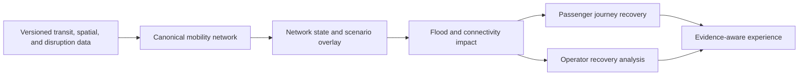

# Transumin-cp — snapshot aplikasi lokal

Repository: https://github.com/Justindwinata/Transumin-cp

Snapshot kode TRANSUM-IN NEXUS yang diuji pada 22 Oktober 2026. Fitur lokal mencakup pencarian multimoda, empat ranking, perjalanan aktif, laporan, review admin dan recovery. Gunakan dokumen delivery terbaru untuk batas bukti; dokumen fase lama di bawah adalah riwayat, bukan status produk terkini.

**Repository publik ini adalah backup kode dan kontrak, bukan backup database/dataset/secret.** Untuk memulihkan kondisi lokal yang sama, diperlukan backup privat 29 Oktober 2026. Jadwal historis bukan ETA realtime. Lihat [petunjuk pemulihan](docs/delivery/RESTORE-20261029.md).

# TRANSUM-IN NEXUS

**Academic theme:** TRANSUM-IN: An Adaptive Multimodal Urban Mobility Decision Support System for Flood Disruption Analysis and Journey Recovery.

TRANSUM-IN NEXUS is an academic decision-support platform concept for representing multimodal mobility conditions, analyzing flood-related network disruption, repairing affected passenger journeys, supporting operator-oriented service-recovery analysis, and presenting grounded explanations. It is not a generic map, a flood dashboard, an autonomous dispatch system, or a chatbot wrapper.

## Intended value

For passengers, the product direction is to make disrupted travel decisions understandable: compare feasible multimodal journeys, expose the evidence behind network conditions, preserve completed or still-valid journey legs where possible, and explain recovery choices without presenting simulated data as live data.

For operators and researchers, the direction is to provide reproducible network-state analysis, flood-impact propagation, scenario replay, TransJakarta split-service analysis, explicit assumptions, measurable baselines, and auditable experiment outputs. The product supports human decisions; it does not claim autonomous operational authority.

## Architecture direction

The executable system is a pnpm TypeScript monorepo with a Next.js web application, a NestJS modular-monolith API, OpenAPI-derived shared contract types, and a containerized PostgreSQL/PostGIS development database. Accepted Phases 1–5 add versioned transit/spatial data, operational state, disruption intelligence, OTP-backed multimodal planning, Active Journeys, targeted alerts, and passenger recovery. Final product UI, operator recovery, and grounded copilot implementation remain separate work.



## Ownership

Student A owns the Mobility Intelligence research layer: canonical transit and spatial integration, GIS/network modeling, mobility state, flood/network impact, and reproducible scenarios. Student B, Justin Dwinata, is Product Owner and owns end-to-end product architecture, journey orchestration, state-aware recovery, frontend and backend product integration, grounded copilot behavior, deployment direction, and final delivery. Operator recovery and research integration are shared through explicit typed contracts without merging the students' distinct research contributions.

## Evidence semantics

Operational condition and evidence are separate concepts. Condition is `AVAILABLE`, `DEGRADED`, `DISRUPTED`, `UNAVAILABLE`, `RECOVERING`, or `UNKNOWN`; evidence is `SCHEDULED`, `OBSERVED`, `LIVE`, `FORECAST`, `SIMULATED`, or `ESTIMATED`. A result may be available while still being simulated or estimated. Nothing may be called live, validated, accurate, optimized, or production-ready without the required source and verification evidence.

## Repository map

| Path                          | Responsibility                                                                  |
| ----------------------------- | ------------------------------------------------------------------------------- |
| `apps/web`                    | Next.js passenger MVP backed by the canonical journey, alert, and recovery APIs |
| `apps/api`                    | NestJS modular monolith, domain modules, database, liveness, and readiness      |
| `packages/shared-types`       | Types generated from the canonical OpenAPI contract                             |
| `packages/config`             | Documentation-only boundary; no premature runtime package                       |
| `database`                    | Reserved boundary for future database-level artifacts                           |
| `data`                        | Source registry, manifests, licenses, fixtures, and ignored working datasets    |
| `research`                    | Reproducible benchmarks, scenarios, experiments, and manifests                  |
| `scripts`                     | Development automation plus future data/research boundaries                     |
| `tests/e2e`                   | Future cross-application end-to-end verification                                |
| `docs/specifications`         | Authority index plus context documents 00–09 and baseline 10–19                 |
| `docs/audits`                 | Evidence-backed phase and repository audits                                     |
| `docs/traceability`           | Requirement-to-contract traceability evidence                                   |
| `docs/adr`                    | Accepted architecture decision records                                          |
| `docs/api`                    | Canonical OpenAPI contract and API documentation                                |
| `docs/tooling`                | Development-tool governance, including Taste Skill                              |
| `infra/docker`                | Multi-architecture PostgreSQL/PostGIS development image                         |
| `artifacts/evaluation`        | Research/evaluation manifests and selected outputs                              |
| `.agents`, `skills-lock.json` | Approved AI-development tooling; not application runtime dependencies           |

## Development status

**Product Owner accepted:** Phase 4 = PASS and Phase 5 = PASS at commit `5e4009a994c2753f45b8bc62778459f7cf0a7dbd`. The controlled research system includes multimodal journey planning, persistent Active Journeys, progress-aware impact, journey/owner-scoped alerts, State-Aware Recovery with middle-span repair and feasible original-suffix rejoin, and a same-state FULL REPLAN baseline. The Phase-5 audit and machine-readable comparison manifest record frozen research metrics and reproducible acceptance evidence; they are **not** a completed final quantitative benchmark.

Restricted rail routing inputs and graph artifacts remain local/non-redistributed; production operator access is unresolved. The Product Owner accepts PRODUCT-P1 Passenger MVP v0.1 as PASS at commit `98a62772045c4ede3662a437756e936f277fee5f`: readable stop search, real OTP alternatives, independent Active Journeys, controlled progress, targeted SSE, and recovery comparison. This is not production readiness. The supervisor-approved scope extension is [SCX-0](docs/reconciliation/SCX-0-SUPERVISOR-SCOPE-EXTENSION.md): approved for reconciliation, **not implemented**, with feature scope frozen after that extension. Operator recovery, AI/copilot provider integration, production authentication, and final quantitative evaluation remain outstanding. EXP-B1 Recovery Evaluation Pilot remains a **recommended research milestone**, not an authorized run or final result. Future numbered phase assignment requires an explicit Product Owner decision; see the [legacy roadmap status note](docs/specifications/context/00-09/09-DEVELOPMENT-ROADMAP.md) and [audit index](docs/audits/README.md).

## Toolchain

- Node.js `22.23.2`
- pnpm `11.25.0`
- TypeScript `5.9.3`
- Next.js `16.3.8` with React `19.3.0`
- NestJS `12.1.0`
- Tailwind CSS `4.3.3`
- PostgreSQL `17.11` with PostGIS `3.6.4`
- Kysely `0.29.6` with `pg` `8.23.0`

Exact decisions and compatibility rationale are recorded in [`ADR-005`](docs/adr/ADR-005-DEVELOPMENT-TOOLCHAIN.md) and [`ADR-006`](docs/adr/ADR-006-DATABASE-INFRASTRUCTURE.md).

## Local development

Use a Node version manager that reads `.node-version`. Copy `.env.example` to the ignored `.env` file, set non-empty local `POSTGRES_DB`, `POSTGRES_USER`, and `POSTGRES_PASSWORD` values, then run:

```bash
pnpm install --frozen-lockfile
pnpm db:up
pnpm db:migrate
pnpm dev:web
pnpm dev:api
```

The web foundation uses `http://localhost:3000`. The API uses `http://localhost:3001`, with process liveness at `GET /health/live`, PostgreSQL/PostGIS readiness at `GET /health/ready`, and provenance reads at `GET /api/v1/data-sources` plus `GET /api/v1/data-sources/{sourceId}/versions`. PostgreSQL is bound only to `127.0.0.1:5433`.

For the passenger MVP, start the verified local OTP graph (`pnpm otp:preflight`, `pnpm otp:start`, `pnpm otp:health`) and set `PASSENGER_NETWORK_SNAPSHOT_ID` to the finalized snapshot used by that graph. `PASSENGER_API_BASE_URL` is the server-side Next.js proxy target; browser requests remain same-origin. Search uses readable canonical stop/station names and Jakarta departure time; coordinates are an advanced fallback. Historical trips are marked as controlled research journeys, with manual progress time rather than implied live tracking. Journey alerts use owner/journey-scoped SSE with REST for initial reads and reconnect catch-up. Run `pnpm --filter @transum-in/web test:e2e` for real OTP plan → activation → progress, `pnpm --filter @transum-in/web test:browser:e2e` for the two-owner browser flow, and `pnpm data:product-p1:verify` for real OTP → two active journeys → controlled SIMULATED Twin disruption → scoped alert → recovery. The controlled acceptance tooling writes test evidence to the configured research database; it must not be run against production.

Root commands:

| Command                                                    | Purpose                                                                                                                                                                      |
| ---------------------------------------------------------- | ---------------------------------------------------------------------------------------------------------------------------------------------------------------------------- |
| `pnpm dev`                                                 | Run the web and API development processes                                                                                                                                    |
| `pnpm db:up`                                               | Build and start the project PostgreSQL/PostGIS service                                                                                                                       |
| `pnpm db:down`                                             | Stop services while preserving the database volume                                                                                                                           |
| `pnpm db:migrate`                                          | Apply pending version-controlled migrations                                                                                                                                  |
| `pnpm db:status`                                           | Report applied and pending migrations without secrets                                                                                                                        |
| `pnpm db:reset`                                            | Delete only the local project DB volume, recreate, migrate                                                                                                                   |
| `pnpm lint`                                                | Lint active TypeScript sources                                                                                                                                               |
| `pnpm typecheck`                                           | Typecheck all active workspace packages                                                                                                                                      |
| `pnpm test`                                                | Run the API foundation unit test                                                                                                                                             |
| `pnpm check:integration`                                   | Run database, PostGIS, migration, and readiness tests                                                                                                                        |
| `pnpm openapi:validate`                                    | Semantically validate the canonical OpenAPI document                                                                                                                         |
| `pnpm api:types`                                           | Regenerate derived OpenAPI TypeScript types                                                                                                                                  |
| `pnpm build`                                               | Build web, API, and shared types                                                                                                                                             |
| `pnpm check`                                               | Run the complete deterministic local quality gate                                                                                                                            |
| `pnpm format:check`                                        | Verify formatting without modifying files                                                                                                                                    |
| `pnpm --filter @transum-in/api data:full-product-role-e2e` | Full product role E2E (owned scratch, prod Next, HTTPS loopback, SAMPLE accounts, role/session/origin checks) — evidence `.release-evidence/full-product-role-e2e/<run-id>/` |

## Local production deployment preparation (partial verification)

Disposable production-mode rehearsal (requires existing local PostGIS image and production builds):

```sh
pnpm check
pnpm --filter @transum-in/api exec tsx src/infrastructure/database/deployment-rehearsal.cli.ts
```

Runner creates a UUID-labeled container on a random loopback port, never reads `.env`, and never mounts product volumes. Checks 17 migrations, latest migration rollback/reapply, non-SUPERUSER runtime permissions, transaction rollback/commit, PostGIS, indexes/constraints, custom-format backup/restore row parity, production startup, local self-signed HTTPS, and API restart. SAMPLE fixture only: this does not verify recovery of product data or full passenger routing. Successful runs remove only their owned container/volume and temporary files; failures retain owned resources for inspection. Production infrastructure and public TLS remain unverified.

This is a reproducible preparation runbook, not a production approval or publication. Product DB changes, DB role changes, OTP graph publication, and public exposure require separate Product Owner maintenance approval. Do not run controlled acceptance commands against production.

### Runtime shape and prerequisites

```text
HTTPS reverse proxy
  -> Next.js web process (loopback, port 3000)
  -> NestJS API (loopback, port 3001)
  -> private PostgreSQL/PostGIS
  -> local/private OTP routing engine (default port 8080)
```

Use Node `22.23.2`, pnpm `11.25.0`, a pinned source commit, a private PostgreSQL/PostGIS network, and a routing graph built from approved, locally retained inputs. Restricted rail inputs and graph artifacts must remain non-redistributed. Local OTP startup targets arm64 macOS through `scripts/routing/otp-phase4ba.sh`. Linux preparation is in `infra/deployment/transum-otp.service` with explicit loopback bind and checksum prestart checks; it requires provisioned Linux Java/OTP artifacts and target-host runtime validation. The macOS script is not portable.

Required configuration comes from a secret manager or protected process environment, never an image, repository, frontend bundle, or shell history:

- `APP_ENV=production`, `NODE_ENV=production`
- `API_HOST=127.0.0.1`, `API_PORT=3001`, web port `3000`
- `DATABASE_URL` or discrete DB fields; DB host remains private
- `PASSENGER_SESSION_SECRET` with at least 32 random characters
- `PASSENGER_SERVICE_TOKEN` with least scope needed by the web-to-API proxy
- `PASSENGER_API_BASE_URL` pointing to private API origin
- `PASSENGER_NETWORK_SNAPSHOT_ID` matching deployed OTP graph snapshot
- `OTP_URL` pointing to private OTP
- `ROUTING_PROVIDER_URL` only when an approved adapter requires it
- `CONTROLLED_REVIEW_ENABLED=false`; do not set controlled review secrets in production

`PASSENGER_SESSION_SECRET` absence fails passenger proxy requests closed. API `API_HOST` currently rejects non-loopback values because prototype passenger sessions are not production authentication. Therefore place HTTPS termination and public access in a reverse proxy on the same host, or obtain an explicit auth/network architecture approval before changing this constraint.

### Prepare, start, and verify

Run from a clean checkout at approved commit. Supervisor must inject environment before startup: package `start` commands do not load root `.env` through `scripts/dev/with-env.mjs`. Keep any secret file outside release checkout, owner-readable only (`0600`). Run each foreground service in a separate supervisor unit/terminal; build commands below are future operator steps, not evidence executed in this session:

```bash
pnpm install --frozen-lockfile
pnpm --filter @transum-in/web build
pnpm --filter @transum-in/api build
pnpm --filter @transum-in/api db:status
API_HOST=127.0.0.1 pnpm --filter @transum-in/api start
pnpm --filter @transum-in/web exec next start --hostname 127.0.0.1 --port 3000
```

Run migrations only after separate product maintenance approval, backup/recovery confirmation, and least-privilege role review:

```bash
pnpm db:migrate
```

Do not run `pnpm db:reset`, acceptance seed/demo commands, or research verification against production. Use a non-root process supervisor with one web and one API process, automatic restart on crash with backoff/restart ceiling, graceful stop, bounded stdout/stderr retention, and explicit CPU, memory, open-file and process-count limits. Set measured limits before rollout rather than inventing capacity numbers; current API pool caps connections at 10 per process. Keep OTP heap plus native-memory headroom within host budget. Configure HTTPS proxy to preserve original `Host`, reject arbitrary hosts, constrain request bodies/rates/concurrency, and disable SSE response buffering/cache with stream-compatible timeouts. Production passenger mutations expect HTTPS origins and production cookies are Secure; plain HTTP is not a valid production smoke test. Keep OTP separately supervised; its current local pattern is:

```bash
pnpm otp:preflight
pnpm otp:start
pnpm otp:health
```

These are future operator steps only: preflight can download runtime artifacts, and start changes OTP state. Do not run them during read-only preparation. Existing production-restart browser harness is isolated acceptance tooling, not a deployment supervisor. Never point it at product DB.

For OTP graph deployment, verify graph file, snapshot ID, input manifest, checksums, Java/OTP versions, and private bind address before start. Current script uses `-Xmx5G` serving and `-Xmx6G` graph build; do not copy those limits to a smaller host without capacity review.

After every restart or rollout, check only non-secret responses:

```bash
curl -fsS https://PUBLIC_HOST/
curl -fsS https://PUBLIC_HOST/api/passenger/journeys/planning-health
curl -fsS http://127.0.0.1:3001/health/live
curl -fsS http://127.0.0.1:3001/health/ready
curl -fsS -H 'Content-Type: application/json' -d '{"query":"{ __typename }"}' "$OTP_URL"
```

`/health/live` proves API process liveness. `/health/ready` proves PostgreSQL/PostGIS readiness. OTP health proves routing reachability only. Do not treat any of these as proof of HTTPS, auth, data freshness, or production correctness. Monitor status, restart count, response latency/error rate, DB connections/storage, OTP memory/CPU, disk, and logs. Redact passwords, tokens, cookies, precise locations, and full sensitive copilot context; preserve correlation/request IDs where implementation provides them.

### Secret rotation

1. Create replacement secret in secret manager; never print it or place it in a command argument.
2. Confirm old and new values have distinct versions and access policy; record owner, timestamp, scope, and expiry without recording secret value.
3. Deploy new environment to one non-public instance or approved maintenance window.
4. Restart affected web/API processes gracefully; existing sessions may expire because cookie signatures use `PASSENGER_SESSION_SECRET`.
5. Check liveness, readiness, passenger proxy response, logs, and error rate without logging headers or cookies.
6. Revoke old secret only after verification and rollback window; remove old value from supervisor/container environment and secret-manager versions per retention policy.
7. If compromise suspected, revoke immediately, invalidate sessions, inspect access logs, and preserve incident evidence.

Current passenger signing and service-token checks accept one configured secret, not a key ring. Service-token changes therefore require a coordinated web/API maintenance restart; there is no zero-downtime dual-token overlap. Signing-secret rotation invalidates existing cookies; invalid cookies receive `403` until cleared, and old owner-scoped journeys may become inaccessible. Obtain explicit approval for that identity impact before rotation. Never restore a compromised secret during rollback.

Rotate `DATABASE_URL` credentials only under separately approved DB maintenance, with old/new credential overlap managed by an authorized DB operator. This runbook does not authorize role creation or password changes. Never rotate by editing committed files, `.env.example`, image layers, or shell history. A leaked secret requires rotation, not deletion from repository alone.

### Least privilege (pending separate maintenance approval)

Separate non-login object ownership, controlled migration identity, and runtime login. Runtime needs only reviewed schema usage, table reads/writes and sequence use for actual product flows; no superuser, role/database creation, schema DDL, ingestion, or blanket future grants. Keep web without DB credentials; API alone receives runtime credentials. Inspect SQL-backed code, extensions, existing grants and default privileges before deriving exact grants. Rehearse on an isolated DB with positive product flows and negative DDL/role tests; do not infer least privilege from readiness alone. Rollout exact reviewed grants only in approved maintenance window; preserve old grants/credential mapping for authorized rollback without granting admin rights to runtime. No role SQL is executed or prescribed here.

### Rollout and rollback

Rollout requires: approved commit and artifact digest, clean build evidence, dependency/security scan, backup before any approved migration, graph manifest/checksums, HTTPS certificate plan, supervisor resource limits, and named operator. Use old process as known-good until new web/API health checks pass. Shift traffic only after HTTPS, liveness, readiness, OTP reachability, and smoke route checks pass.

Rollback means stop new processes, restore previous known-good artifact/commit and environment version, restart, then repeat health checks. Do not roll back application code across an incompatible schema change. Restore DB only through approved backup/recovery procedure. No DB migration or role rollout is authorized by this runbook.

### Current production gaps

- Production authentication and operator authorization are unresolved; prototype passenger cookies are not a production identity system.
- Linux proxy/supervisor examples and executable monitoring probes exist in `infra/deployment/`; native syntax is verified, but target-host startup, public TLS, alert delivery, resource sizing and log-retention policy remain unverified.
- API currently enforces loopback-only `API_HOST`; public deployment needs same-host HTTPS proxy or approved architecture change.
- `/health/ready` covers DB/PostGIS, not OTP, web, certificate, or dataset freshness.
- Linux OTP unit is preparation-only: provisioned Java/OTP, checksum-approved graph, memory budget and real Linux startup remain unverified; controlled rail-source access/redistribution restrictions remain.
- Least-privilege DB runtime/migration roles and maintenance approval remain pending.
- Disposable rehearsal verifies production builds/startup, local self-signed HTTPS, API restart, DB outage recovery, live API/Web/PostGIS/OTP probes, latest empty-schema migration rollback/reapply, and SAMPLE backup/restore. Exact-grants full passenger acceptance and populated journey-data restore remain pending evidence. Public TLS, alert delivery, secret rotation, and product-data rollback/restore remain NOT VERIFIED.

## Phase lifecycle

Work advances only through Product Owner authorization and phase exit gates. Phases 4 and 5 are accepted as PASS; the historical File 09 phase numbering is not the current execution order. No post-Phase-5 numbered phase or EXP-B1 implementation is authorized by this status reconciliation.

## Documentation

Start with [`docs/specifications/README.md`](docs/specifications/README.md), then the relevant Phase 0.2 canonical contracts and ADRs, followed by baseline 10–19. Consult context 00–09 only where newer authority is silent. AI agents must also follow [`AGENTS.md`](AGENTS.md) and the complete File 15 playbook.

No deployment link, realtime claim, performance claim, or product-data claim is published by this foundation. Local database readiness means only that PostgreSQL and PostGIS answered the technical probe.

## Independent takeover checkpoint — 2026-10-19

The latest integrated source is the `integration/full-product-local-uat` branch at `7f24b0420a9a38387b5c9c7e344b1dad4ef9967e`. The `codex/deployment-readiness` branch adds verified dependency remediation, shared-type bootstrap, explicit source-only dataset checks, and CI endpoint corrections. See the [takeover audit](docs/audits/TAKEOVER-AND-DEPLOYMENT-READINESS-20261019.md) before using earlier release claims. No final-product or public deployment acceptance is implied.

Use `pnpm check:source` after a fresh frozen-lockfile install when private raw/processed datasets are absent. It explicitly reports local artifact availability as NOT VERIFIED while checking tracked contracts and source. Use `pnpm check` with the manifested local inputs for full checks. Production dependency audit is `pnpm audit --prod --audit-level high`; all-dependency audit still reports an unpatched development-only braces advisory, documented in the audit.

## Passenger local stability — 2026-10-19

See [passenger stability delivery](docs/delivery/PASSENGER-LOCAL-STABILITY-20261019.md) for GPS recovery, input invalidation, real routing coverage, provider handoff, and the isolated `pnpm passenger:local` lifecycle. The local runtime uses the explicitly historical scheduled dataset; current schedules, physical GPS validation and provider booking remain separate gates. `--managed-volume` avoids Docker Desktop shared-directory ownership failures without touching product volumes.

See [routing core stabilization](docs/delivery/PASSENGER-ROUTING-CORE-20261020.md) for FR-001/002 candidate portfolio policy, distinct transit choices, active-journey preference regression and current verification limits.
