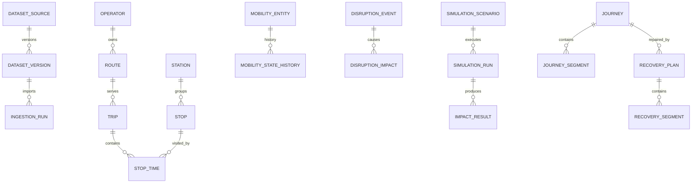

# TRANSUM-IN NEXUS
# 12 — DATABASE & ERD SPECIFICATION — FINAL ENGINEERING EDITION

**Academic Theme:** TRANSUM-IN: AN ADAPTIVE MULTIMODAL URBAN MOBILITY DECISION SUPPORT SYSTEM FOR FLOOD DISRUPTION ANALYSIS AND JOURNEY RECOVERY

**Status:** FROZEN DATABASE IMPLEMENTATION BASELINE

**Audience:** Product Owner, Student A, Student B, AI Coding Agent, Reviewer, Capstone Supervisor

---

## 1. Purpose

Database adalah foundation untuk transit integration, spatial intelligence, mobility twin, simulation, passenger recovery, operator recovery, dan reproducible research.

## 2. Technology Decision

- PostgreSQL primary database.
- PostGIS spatial extension.
- JSONB hanya untuk config/metadata semi-structured.
- Migration version-controlled.

## 3. Logical Schemas

- meta
- transit
- spatial
- twin
- disruption
- simulation
- journey
- research
- auth
- ai

## 4. High-Level ERD

## 5. Detailed Table Catalogue

### `dataset_source`

**Purpose:** Sumber canonical dataset.

**Fields / constraints:**

- `id UUID PK`
- `name`
- `provider`
- `source_type`
- `canonical_url`
- `license_name`
- `license_url`
- `access_notes`
- `active`
- `created_at`
- `updated_at`

**Implementation rules:**

- UUID primary key kecuali bridge table tertentu.
- Critical FK memakai explicit delete policy.
- Timestamp menggunakan `timestamptz` kecuali service-time semantics.
- External IDs bukan global PK.
- Semua production/research rows harus traceable ke source/run jika berasal dari external/derived data.

**Testing requirements:**

- Insert valid `dataset_source` record.
- Reject structurally invalid `dataset_source` record.
- Verify indexes/foreign-key behavior yang relevan.

---

### `dataset_version`

**Purpose:** Snapshot/version dataset.

**Fields / constraints:**

- `id UUID PK`
- `source_id FK`
- `version_label`
- `checksum_sha256`
- `retrieved_at`
- `effective_from`
- `effective_to`
- `raw_path_ref`
- `validation_status`
- `metadata_json`

**Implementation rules:**

- UUID primary key kecuali bridge table tertentu.
- Critical FK memakai explicit delete policy.
- Timestamp menggunakan `timestamptz` kecuali service-time semantics.
- External IDs bukan global PK.
- Semua production/research rows harus traceable ke source/run jika berasal dari external/derived data.

**Testing requirements:**

- Insert valid `dataset_version` record.
- Reject structurally invalid `dataset_version` record.
- Verify indexes/foreign-key behavior yang relevan.

---

### `ingestion_run`

**Purpose:** Audit ingestion.

**Fields / constraints:**

- `id UUID PK`
- `dataset_version_id FK`
- `started_at`
- `completed_at`
- `status`
- `records_read`
- `records_written`
- `records_rejected`
- `error_summary`

**Implementation rules:**

- UUID primary key kecuali bridge table tertentu.
- Critical FK memakai explicit delete policy.
- Timestamp menggunakan `timestamptz` kecuali service-time semantics.
- External IDs bukan global PK.
- Semua production/research rows harus traceable ke source/run jika berasal dari external/derived data.

**Testing requirements:**

- Insert valid `ingestion_run` record.
- Reject structurally invalid `ingestion_run` record.
- Verify indexes/foreign-key behavior yang relevan.

---

### `operator`

**Purpose:** Operator transportasi.

**Fields / constraints:**

- `id UUID PK`
- `code UNIQUE`
- `name`
- `mode_group`
- `source_version_id FK`
- `active`

**Implementation rules:**

- UUID primary key kecuali bridge table tertentu.
- Critical FK memakai explicit delete policy.
- Timestamp menggunakan `timestamptz` kecuali service-time semantics.
- External IDs bukan global PK.
- Semua production/research rows harus traceable ke source/run jika berasal dari external/derived data.

**Testing requirements:**

- Insert valid `operator` record.
- Reject structurally invalid `operator` record.
- Verify indexes/foreign-key behavior yang relevan.

---

### `route`

**Purpose:** Rute canonical.

**Fields / constraints:**

- `id UUID PK`
- `operator_id FK`
- `external_id`
- `short_name`
- `long_name`
- `mode`
- `geometry_id FK nullable`
- `active`

**Implementation rules:**

- UUID primary key kecuali bridge table tertentu.
- Critical FK memakai explicit delete policy.
- Timestamp menggunakan `timestamptz` kecuali service-time semantics.
- External IDs bukan global PK.
- Semua production/research rows harus traceable ke source/run jika berasal dari external/derived data.

**Testing requirements:**

- Insert valid `route` record.
- Reject structurally invalid `route` record.
- Verify indexes/foreign-key behavior yang relevan.

---

### `station`

**Purpose:** Hub/station canonical.

**Fields / constraints:**

- `id UUID PK`
- `external_id`
- `name`
- `geom geometry(Point,4326)`
- `station_type`
- `parent_station_id nullable`
- `source_version_id FK`

**Implementation rules:**

- UUID primary key kecuali bridge table tertentu.
- Critical FK memakai explicit delete policy.
- Timestamp menggunakan `timestamptz` kecuali service-time semantics.
- External IDs bukan global PK.
- Semua production/research rows harus traceable ke source/run jika berasal dari external/derived data.

**Testing requirements:**

- Insert valid `station` record.
- Reject structurally invalid `station` record.
- Verify indexes/foreign-key behavior yang relevan.

---

### `stop`

**Purpose:** Boarding/alighting point.

**Fields / constraints:**

- `id UUID PK`
- `station_id FK nullable`
- `external_id`
- `name`
- `geom geometry(Point,4326)`
- `source_version_id FK`

**Implementation rules:**

- UUID primary key kecuali bridge table tertentu.
- Critical FK memakai explicit delete policy.
- Timestamp menggunakan `timestamptz` kecuali service-time semantics.
- External IDs bukan global PK.
- Semua production/research rows harus traceable ke source/run jika berasal dari external/derived data.

**Testing requirements:**

- Insert valid `stop` record.
- Reject structurally invalid `stop` record.
- Verify indexes/foreign-key behavior yang relevan.

---

### `service_calendar`

**Purpose:** Service validity.

**Fields / constraints:**

- `id UUID PK`
- `operator_id FK`
- `service_code`
- `start_date`
- `end_date`
- `weekday flags`
- `source_version_id FK`

**Implementation rules:**

- UUID primary key kecuali bridge table tertentu.
- Critical FK memakai explicit delete policy.
- Timestamp menggunakan `timestamptz` kecuali service-time semantics.
- External IDs bukan global PK.
- Semua production/research rows harus traceable ke source/run jika berasal dari external/derived data.

**Testing requirements:**

- Insert valid `service_calendar` record.
- Reject structurally invalid `service_calendar` record.
- Verify indexes/foreign-key behavior yang relevan.

---

### `trip`

**Purpose:** Scheduled service trip.

**Fields / constraints:**

- `id UUID PK`
- `route_id FK`
- `service_calendar_id FK`
- `external_id`
- `direction_id`
- `headsign`
- `source_version_id FK`

**Implementation rules:**

- UUID primary key kecuali bridge table tertentu.
- Critical FK memakai explicit delete policy.
- Timestamp menggunakan `timestamptz` kecuali service-time semantics.
- External IDs bukan global PK.
- Semua production/research rows harus traceable ke source/run jika berasal dari external/derived data.

**Testing requirements:**

- Insert valid `trip` record.
- Reject structurally invalid `trip` record.
- Verify indexes/foreign-key behavior yang relevan.

---

### `stop_time`

**Purpose:** Trip sequence timing.

**Fields / constraints:**

- `id UUID PK`
- `trip_id FK`
- `stop_id FK`
- `stop_sequence`
- `arrival_seconds`
- `departure_seconds`
- `pickup_type`
- `dropoff_type`

**Implementation rules:**

- UUID primary key kecuali bridge table tertentu.
- Critical FK memakai explicit delete policy.
- Timestamp menggunakan `timestamptz` kecuali service-time semantics.
- External IDs bukan global PK.
- Semua production/research rows harus traceable ke source/run jika berasal dari external/derived data.

**Testing requirements:**

- Insert valid `stop_time` record.
- Reject structurally invalid `stop_time` record.
- Verify indexes/foreign-key behavior yang relevan.

---

### `transit_shape`

**Purpose:** Route/trip geometry.

**Fields / constraints:**

- `id UUID PK`
- `route_id FK nullable`
- `trip_id FK nullable`
- `geom geometry(LineString,4326)`
- `source_version_id FK`

**Implementation rules:**

- UUID primary key kecuali bridge table tertentu.
- Critical FK memakai explicit delete policy.
- Timestamp menggunakan `timestamptz` kecuali service-time semantics.
- External IDs bukan global PK.
- Semua production/research rows harus traceable ke source/run jika berasal dari external/derived data.

**Testing requirements:**

- Insert valid `transit_shape` record.
- Reject structurally invalid `transit_shape` record.
- Verify indexes/foreign-key behavior yang relevan.

---

### `transfer`

**Purpose:** Canonical transfer edge.

**Fields / constraints:**

- `id UUID PK`
- `from_stop_id FK`
- `to_stop_id FK`
- `transfer_type`
- `min_transfer_seconds`
- `walking_distance_m`
- `geom nullable`
- `validation_status`

**Implementation rules:**

- UUID primary key kecuali bridge table tertentu.
- Critical FK memakai explicit delete policy.
- Timestamp menggunakan `timestamptz` kecuali service-time semantics.
- External IDs bukan global PK.
- Semua production/research rows harus traceable ke source/run jika berasal dari external/derived data.

**Testing requirements:**

- Insert valid `transfer` record.
- Reject structurally invalid `transfer` record.
- Verify indexes/foreign-key behavior yang relevan.

---

### `road_segment`

**Purpose:** Relevant road network segment.

**Fields / constraints:**

- `id UUID PK`
- `external_id`
- `name`
- `geom geometry(LineString,4326)`
- `road_class`
- `access_meta JSONB`
- `source_version_id FK`

**Implementation rules:**

- UUID primary key kecuali bridge table tertentu.
- Critical FK memakai explicit delete policy.
- Timestamp menggunakan `timestamptz` kecuali service-time semantics.
- External IDs bukan global PK.
- Semua production/research rows harus traceable ke source/run jika berasal dari external/derived data.

**Testing requirements:**

- Insert valid `road_segment` record.
- Reject structurally invalid `road_segment` record.
- Verify indexes/foreign-key behavior yang relevan.

---

### `walking_edge`

**Purpose:** Pedestrian transfer/network edge.

**Fields / constraints:**

- `id UUID PK`
- `from_node_ref`
- `to_node_ref`
- `geom`
- `distance_m`
- `duration_s`
- `accessibility_meta JSONB`
- `source_version_id FK`

**Implementation rules:**

- UUID primary key kecuali bridge table tertentu.
- Critical FK memakai explicit delete policy.
- Timestamp menggunakan `timestamptz` kecuali service-time semantics.
- External IDs bukan global PK.
- Semua production/research rows harus traceable ke source/run jika berasal dari external/derived data.

**Testing requirements:**

- Insert valid `walking_edge` record.
- Reject structurally invalid `walking_edge` record.
- Verify indexes/foreign-key behavior yang relevan.

---

### `mobility_entity`

**Purpose:** Twin registry.

**Fields / constraints:**

- `id UUID PK`
- `entity_type`
- `reference_table`
- `reference_id`
- `active`
- `created_at`

**Implementation rules:**

- UUID primary key kecuali bridge table tertentu.
- Critical FK memakai explicit delete policy.
- Timestamp menggunakan `timestamptz` kecuali service-time semantics.
- External IDs bukan global PK.
- Semua production/research rows harus traceable ke source/run jika berasal dari external/derived data.

**Testing requirements:**

- Insert valid `mobility_entity` record.
- Reject structurally invalid `mobility_entity` record.
- Verify indexes/foreign-key behavior yang relevan.

---

### `mobility_state`

**Purpose:** Resolved current/base state.

**Fields / constraints:**

- `id UUID PK`
- `mobility_entity_id FK`
- `availability_state`
- `evidence_type`
- `reason_code`
- `source_ref`
- `valid_from`
- `valid_until`
- `confidence`
- `updated_at`

**Implementation rules:**

- UUID primary key kecuali bridge table tertentu.
- Critical FK memakai explicit delete policy.
- Timestamp menggunakan `timestamptz` kecuali service-time semantics.
- External IDs bukan global PK.
- Semua production/research rows harus traceable ke source/run jika berasal dari external/derived data.

**Testing requirements:**

- Insert valid `mobility_state` record.
- Reject structurally invalid `mobility_state` record.
- Verify indexes/foreign-key behavior yang relevan.

---

### `mobility_state_history`

**Purpose:** Immutable state transitions.

**Fields / constraints:**

- `id UUID PK`
- `mobility_entity_id FK`
- `old_state`
- `new_state`
- `evidence_type`
- `reason_code`
- `source_ref`
- `changed_at`

**Implementation rules:**

- UUID primary key kecuali bridge table tertentu.
- Critical FK memakai explicit delete policy.
- Timestamp menggunakan `timestamptz` kecuali service-time semantics.
- External IDs bukan global PK.
- Semua production/research rows harus traceable ke source/run jika berasal dari external/derived data.

**Testing requirements:**

- Insert valid `mobility_state_history` record.
- Reject structurally invalid `mobility_state_history` record.
- Verify indexes/foreign-key behavior yang relevan.

---

### `network_snapshot`

**Purpose:** Reproducible network state.

**Fields / constraints:**

- `id UUID PK`
- `label`
- `dataset_manifest JSONB`
- `base_time`
- `engine_version`
- `checksum`
- `created_at`

**Implementation rules:**

- UUID primary key kecuali bridge table tertentu.
- Critical FK memakai explicit delete policy.
- Timestamp menggunakan `timestamptz` kecuali service-time semantics.
- External IDs bukan global PK.
- Semua production/research rows harus traceable ke source/run jika berasal dari external/derived data.

**Testing requirements:**

- Insert valid `network_snapshot` record.
- Reject structurally invalid `network_snapshot` record.
- Verify indexes/foreign-key behavior yang relevan.

---

### `disruption_event`

**Purpose:** Generic disruption.

**Fields / constraints:**

- `id UUID PK`
- `event_type`
- `title`
- `severity`
- `evidence_type`
- `source_ref`
- `valid_from`
- `valid_until`
- `status`
- `geom geometry(Geometry,4326)`

**Implementation rules:**

- UUID primary key kecuali bridge table tertentu.
- Critical FK memakai explicit delete policy.
- Timestamp menggunakan `timestamptz` kecuali service-time semantics.
- External IDs bukan global PK.
- Semua production/research rows harus traceable ke source/run jika berasal dari external/derived data.

**Testing requirements:**

- Insert valid `disruption_event` record.
- Reject structurally invalid `disruption_event` record.
- Verify indexes/foreign-key behavior yang relevan.

---

### `flood_event_detail`

**Purpose:** Flood-specific attributes.

**Fields / constraints:**

- `disruption_event_id UUID PK/FK`
- `water_depth_cm nullable`
- `radius_m nullable`
- `confidence nullable`
- `notes`

**Implementation rules:**

- UUID primary key kecuali bridge table tertentu.
- Critical FK memakai explicit delete policy.
- Timestamp menggunakan `timestamptz` kecuali service-time semantics.
- External IDs bukan global PK.
- Semua production/research rows harus traceable ke source/run jika berasal dari external/derived data.

**Testing requirements:**

- Insert valid `flood_event_detail` record.
- Reject structurally invalid `flood_event_detail` record.
- Verify indexes/foreign-key behavior yang relevan.

---

### `disruption_impact`

**Purpose:** Direct/propagated effect.

**Fields / constraints:**

- `id UUID PK`
- `disruption_event_id FK`
- `mobility_entity_id FK`
- `impact_type`
- `blockage_status`
- `impact_level`
- `derivation_method`
- `created_at`

**Implementation rules:**

- UUID primary key kecuali bridge table tertentu.
- Critical FK memakai explicit delete policy.
- Timestamp menggunakan `timestamptz` kecuali service-time semantics.
- External IDs bukan global PK.
- Semua production/research rows harus traceable ke source/run jika berasal dari external/derived data.

**Testing requirements:**

- Insert valid `disruption_impact` record.
- Reject structurally invalid `disruption_impact` record.
- Verify indexes/foreign-key behavior yang relevan.

---

### `simulation_scenario`

**Purpose:** What-if definition.

**Fields / constraints:**

- `id UUID PK`
- `name`
- `scenario_type`
- `base_snapshot_id FK`
- `config_json`
- `status`
- `created_by`
- `created_at`

**Implementation rules:**

- UUID primary key kecuali bridge table tertentu.
- Critical FK memakai explicit delete policy.
- Timestamp menggunakan `timestamptz` kecuali service-time semantics.
- External IDs bukan global PK.
- Semua production/research rows harus traceable ke source/run jika berasal dari external/derived data.

**Testing requirements:**

- Insert valid `simulation_scenario` record.
- Reject structurally invalid `simulation_scenario` record.
- Verify indexes/foreign-key behavior yang relevan.

---

### `simulation_run`

**Purpose:** Scenario execution.

**Fields / constraints:**

- `id UUID PK`
- `scenario_id FK`
- `engine_version`
- `started_at`
- `completed_at`
- `status`
- `run_config JSONB`
- `error_summary`

**Implementation rules:**

- UUID primary key kecuali bridge table tertentu.
- Critical FK memakai explicit delete policy.
- Timestamp menggunakan `timestamptz` kecuali service-time semantics.
- External IDs bukan global PK.
- Semua production/research rows harus traceable ke source/run jika berasal dari external/derived data.

**Testing requirements:**

- Insert valid `simulation_run` record.
- Reject structurally invalid `simulation_run` record.
- Verify indexes/foreign-key behavior yang relevan.

---

### `impact_result`

**Purpose:** Scenario/network metrics.

**Fields / constraints:**

- `id UUID PK`
- `simulation_run_id FK`
- `metric_name`
- `entity_scope`
- `metric_value_num nullable`
- `metric_value_json nullable`
- `unit`
- `created_at`

**Implementation rules:**

- UUID primary key kecuali bridge table tertentu.
- Critical FK memakai explicit delete policy.
- Timestamp menggunakan `timestamptz` kecuali service-time semantics.
- External IDs bukan global PK.
- Semua production/research rows harus traceable ke source/run jika berasal dari external/derived data.

**Testing requirements:**

- Insert valid `impact_result` record.
- Reject structurally invalid `impact_result` record.
- Verify indexes/foreign-key behavior yang relevan.

---

### `operator_recovery_plan`

**Purpose:** Operator service recovery.

**Fields / constraints:**

- `id UUID PK`
- `simulation_run_id FK`
- `route_id FK`
- `blocked_segment_ref`
- `upstream_plan JSONB`
- `downstream_plan JSONB`
- `bridge_plan JSONB`
- `estimated_fleet_count`
- `validation_status`
- `assumptions JSONB`

**Implementation rules:**

- UUID primary key kecuali bridge table tertentu.
- Critical FK memakai explicit delete policy.
- Timestamp menggunakan `timestamptz` kecuali service-time semantics.
- External IDs bukan global PK.
- Semua production/research rows harus traceable ke source/run jika berasal dari external/derived data.

**Testing requirements:**

- Insert valid `operator_recovery_plan` record.
- Reject structurally invalid `operator_recovery_plan` record.
- Verify indexes/foreign-key behavior yang relevan.

---

### `journey`

**Purpose:** Passenger journey header.

**Fields / constraints:**

- `id UUID PK`
- `user_id FK nullable`
- `origin_geom`
- `destination_geom`
- `departure_time`
- `preference`
- `status`
- `dataset_manifest JSONB`
- `created_at`

**Implementation rules:**

- UUID primary key kecuali bridge table tertentu.
- Critical FK memakai explicit delete policy.
- Timestamp menggunakan `timestamptz` kecuali service-time semantics.
- External IDs bukan global PK.
- Semua production/research rows harus traceable ke source/run jika berasal dari external/derived data.

**Testing requirements:**

- Insert valid `journey` record.
- Reject structurally invalid `journey` record.
- Verify indexes/foreign-key behavior yang relevan.

---

### `journey_segment`

**Purpose:** Ordered journey leg.

**Fields / constraints:**

- `id UUID PK`
- `journey_id FK`
- `sequence`
- `mode`
- `operator_id FK nullable`
- `route_id FK nullable`
- `from_ref`
- `to_ref`
- `planned_start`
- `planned_end`
- `distance_m`
- `status`

**Implementation rules:**

- UUID primary key kecuali bridge table tertentu.
- Critical FK memakai explicit delete policy.
- Timestamp menggunakan `timestamptz` kecuali service-time semantics.
- External IDs bukan global PK.
- Semua production/research rows harus traceable ke source/run jika berasal dari external/derived data.

**Testing requirements:**

- Insert valid `journey_segment` record.
- Reject structurally invalid `journey_segment` record.
- Verify indexes/foreign-key behavior yang relevan.

---

### `journey_state_event`

**Purpose:** Active journey timeline.

**Fields / constraints:**

- `id UUID PK`
- `journey_id FK`
- `state`
- `segment_id FK nullable`
- `event_time`
- `source`
- `metadata JSONB`

**Implementation rules:**

- UUID primary key kecuali bridge table tertentu.
- Critical FK memakai explicit delete policy.
- Timestamp menggunakan `timestamptz` kecuali service-time semantics.
- External IDs bukan global PK.
- Semua production/research rows harus traceable ke source/run jika berasal dari external/derived data.

**Testing requirements:**

- Insert valid `journey_state_event` record.
- Reject structurally invalid `journey_state_event` record.
- Verify indexes/foreign-key behavior yang relevan.

---

### `recovery_plan`

**Purpose:** Passenger recovery.

**Fields / constraints:**

- `id UUID PK`
- `journey_id FK`
- `disruption_event_id FK nullable`
- `simulation_run_id FK nullable`
- `baseline_type`
- `status`
- `preserved_segment_count`
- `changed_segment_count`
- `additional_duration_s`
- `additional_transfers`
- `score`
- `explanation_json`
- `created_at`

**Implementation rules:**

- UUID primary key kecuali bridge table tertentu.
- Critical FK memakai explicit delete policy.
- Timestamp menggunakan `timestamptz` kecuali service-time semantics.
- External IDs bukan global PK.
- Semua production/research rows harus traceable ke source/run jika berasal dari external/derived data.

**Testing requirements:**

- Insert valid `recovery_plan` record.
- Reject structurally invalid `recovery_plan` record.
- Verify indexes/foreign-key behavior yang relevan.

---

### `recovery_segment`

**Purpose:** Repaired segments.

**Fields / constraints:**

- `id UUID PK`
- `recovery_plan_id FK`
- `sequence`
- `original_segment_id FK nullable`
- `mode`
- `from_ref`
- `to_ref`
- `duration_s`
- `status`

**Implementation rules:**

- UUID primary key kecuali bridge table tertentu.
- Critical FK memakai explicit delete policy.
- Timestamp menggunakan `timestamptz` kecuali service-time semantics.
- External IDs bukan global PK.
- Semua production/research rows harus traceable ke source/run jika berasal dari external/derived data.

**Testing requirements:**

- Insert valid `recovery_segment` record.
- Reject structurally invalid `recovery_segment` record.
- Verify indexes/foreign-key behavior yang relevan.

---

### `experiment_run`

**Purpose:** Research execution.

**Fields / constraints:**

- `id UUID PK`
- `experiment_code`
- `dataset_manifest`
- `scenario_manifest`
- `algorithm_version`
- `config_json`
- `started_at`
- `completed_at`
- `status`

**Implementation rules:**

- UUID primary key kecuali bridge table tertentu.
- Critical FK memakai explicit delete policy.
- Timestamp menggunakan `timestamptz` kecuali service-time semantics.
- External IDs bukan global PK.
- Semua production/research rows harus traceable ke source/run jika berasal dari external/derived data.

**Testing requirements:**

- Insert valid `experiment_run` record.
- Reject structurally invalid `experiment_run` record.
- Verify indexes/foreign-key behavior yang relevan.

---

### `experiment_metric`

**Purpose:** Experiment metric.

**Fields / constraints:**

- `id UUID PK`
- `experiment_run_id FK`
- `metric_name`
- `metric_value`
- `unit`
- `population_scope`
- `notes`

**Implementation rules:**

- UUID primary key kecuali bridge table tertentu.
- Critical FK memakai explicit delete policy.
- Timestamp menggunakan `timestamptz` kecuali service-time semantics.
- External IDs bukan global PK.
- Semua production/research rows harus traceable ke source/run jika berasal dari external/derived data.

**Testing requirements:**

- Insert valid `experiment_metric` record.
- Reject structurally invalid `experiment_metric` record.
- Verify indexes/foreign-key behavior yang relevan.

---

### `user_account`

**Purpose:** Minimal auth account.

**Fields / constraints:**

- `id UUID PK`
- `email UNIQUE`
- `password_hash/provider_ref`
- `status`
- `created_at`

**Implementation rules:**

- UUID primary key kecuali bridge table tertentu.
- Critical FK memakai explicit delete policy.
- Timestamp menggunakan `timestamptz` kecuali service-time semantics.
- External IDs bukan global PK.
- Semua production/research rows harus traceable ke source/run jika berasal dari external/derived data.

**Testing requirements:**

- Insert valid `user_account` record.
- Reject structurally invalid `user_account` record.
- Verify indexes/foreign-key behavior yang relevan.

---

### `role_assignment`

**Purpose:** Role model.

**Fields / constraints:**

- `id UUID PK`
- `user_id FK`
- `role_code`
- `created_at`

**Implementation rules:**

- UUID primary key kecuali bridge table tertentu.
- Critical FK memakai explicit delete policy.
- Timestamp menggunakan `timestamptz` kecuali service-time semantics.
- External IDs bukan global PK.
- Semua production/research rows harus traceable ke source/run jika berasal dari external/derived data.

**Testing requirements:**

- Insert valid `role_assignment` record.
- Reject structurally invalid `role_assignment` record.
- Verify indexes/foreign-key behavior yang relevan.

---

### `copilot_session`

**Purpose:** Conversation context.

**Fields / constraints:**

- `id UUID PK`
- `user_id FK nullable`
- `journey_id FK nullable`
- `simulation_run_id FK nullable`
- `created_at`

**Implementation rules:**

- UUID primary key kecuali bridge table tertentu.
- Critical FK memakai explicit delete policy.
- Timestamp menggunakan `timestamptz` kecuali service-time semantics.
- External IDs bukan global PK.
- Semua production/research rows harus traceable ke source/run jika berasal dari external/derived data.

**Testing requirements:**

- Insert valid `copilot_session` record.
- Reject structurally invalid `copilot_session` record.
- Verify indexes/foreign-key behavior yang relevan.

---

### `tool_execution_log`

**Purpose:** Auditable copilot tools.

**Fields / constraints:**

- `id UUID PK`
- `session_id FK`
- `tool_name`
- `request_json`
- `response_digest`
- `status`
- `latency_ms`
- `created_at`

**Implementation rules:**

- UUID primary key kecuali bridge table tertentu.
- Critical FK memakai explicit delete policy.
- Timestamp menggunakan `timestamptz` kecuali service-time semantics.
- External IDs bukan global PK.
- Semua production/research rows harus traceable ke source/run jika berasal dari external/derived data.

**Testing requirements:**

- Insert valid `tool_execution_log` record.
- Reject structurally invalid `tool_execution_log` record.
- Verify indexes/foreign-key behavior yang relevan.

---

## 6. Spatial Modeling Rules

- Persist source geometry canonical EPSG:4326.
- Metric distance memakai geography atau projected CRS yang sesuai.
- GiST/SP-GiST index pada geometry penting.
- Invalid geometry ditolak/diperbaiki controlled pipeline.

## 7. GTFS Time Modeling

GTFS dapat memiliki waktu >24:00. Jangan menyimpan hanya SQL TIME. Gunakan seconds-from-service-day atau equivalent.

## 8. Provenance

Imported entity harus dapat dikaitkan ke dataset_version atau ingestion mapping.

## 9. State & Scenario Isolation

`mobility_state` = resolved base/current state. Scenario overlay tidak overwrite base state.

## 10. Index Plan

- operator code unique
- route(operator_id, external_id)
- stop/station GiST geom
- stop_time(trip_id, stop_sequence)
- mobility_state(entity, validity)
- disruption_event GiST geom
- simulation_run(scenario,status)
- journey_segment(journey,sequence)
- experiment_metric(run,metric)

## 11. Migration Order

1. extensions/schema
2. meta
3. transit
4. spatial
5. twin
6. disruption
7. simulation
8. journey
9. research
10. auth
11. ai
12. indexes/views

## 12. Seed Policy

Seed hanya development/test. Real dataset masuk ingestion pipeline.

## 13. Research Snapshot Policy

Experiment merekam exact dataset versions, engine version, scenario config, algorithm config.

## 14. AI Agent Database Guardrails

- Jangan buat tabel baru hanya karena endpoint baru.
- Jangan JSON-everything.
- Jangan ubah kolom tanpa migration.
- Jangan hapus provenance/raw data untuk 'clean-up'.
- Schema change wajib menyebut requirement ID.

## 15. Database Definition of Done

Migration clean dari database kosong, integration test PASS, indexes/constraints tersedia, representative ingestion berhasil.
